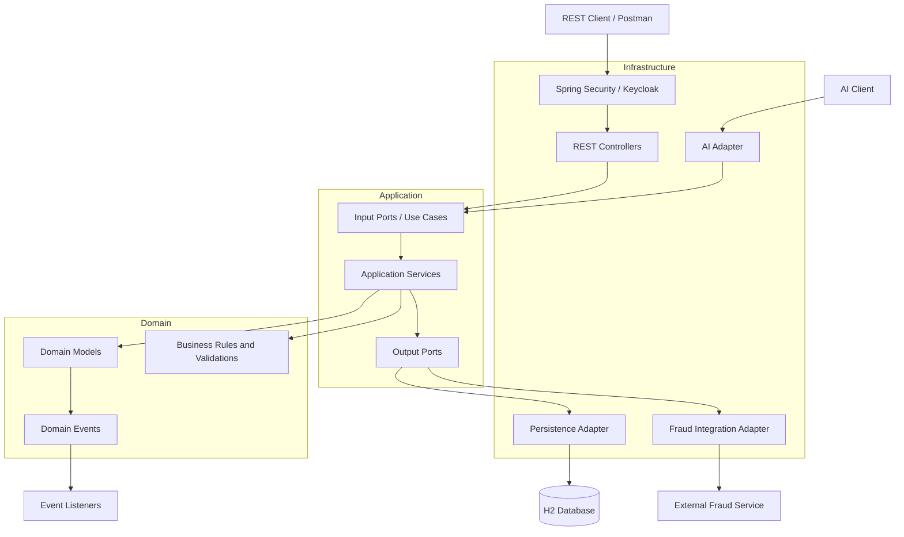
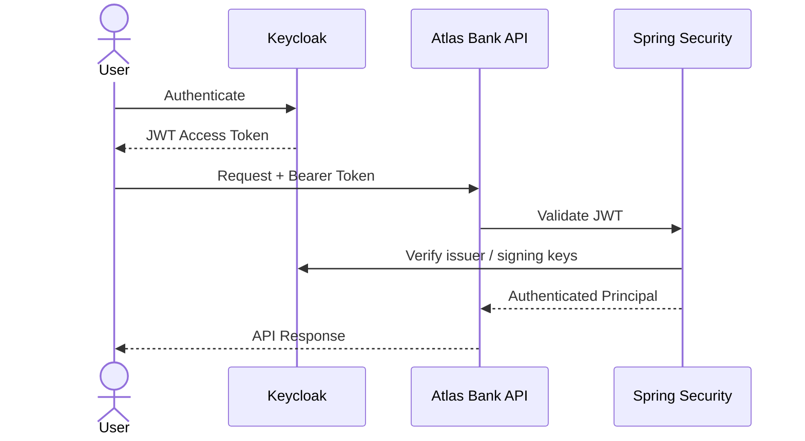

# Atlas Bank

**A Banking Backend built with Java 25, Spring Boot 4 and Hexagonal Architecture**

Atlas Bank is a personal backend engineering project focused on building a modular banking application using Domain-Driven Design (DDD), Hexagonal Architecture (Ports and Adapters), and modern Java and Spring technologies.

The project explores how to design a maintainable banking backend with clear separation of concerns, business-oriented domain models, secure REST APIs, transaction processing, and extensible integrations.

> **Project status:** Under active development. Some capabilities are implemented, while others are planned as part of the technical roadmap.

---

## Table of Contents

- [Overview](#overview)
- [Architecture](#architecture)
- [Technology Stack](#technology-stack)
- [Implemented Features](#implemented-features)
- [Security](#security)
- [Domain Design and Patterns](#domain-design-and-patterns)
- [Persistence](#persistence)
- [Project Structure](#project-structure)
- [Getting Started](#getting-started)
- [Running Tests](#running-tests)
- [API](#api)
- [Roadmap](#roadmap)
- [Engineering Principles](#engineering-principles)

---

## Overview

Atlas Bank is designed as a modular monolith following DDD and Hexagonal Architecture principles.

The main goal is to keep business logic independent of infrastructure concerns, making the application easier to test, maintain, and evolve.

The project currently focuses on:

- Banking account management.
- Money transfers and transaction processing.
- Domain-driven business rules and validations.
- Authentication and authorization using Keycloak and JWT.
- Persistence through Spring Data JPA.
- Fraud-check integration through an outbound port and adapter.
- Domain event handling.
- AI-assisted interactions through Spring AI.

The architecture is designed to allow future evolution towards distributed components and asynchronous communication without prematurely introducing microservices complexity.

---

## Architecture

Atlas Bank follows **Hexagonal Architecture (Ports and Adapters)**, organized into three main layers:

| Layer | Responsibility |
|---|---|
| Domain | Business rules, entities, value objects, domain services, events and validations. |
| Application | Use cases, commands, queries, application services and ports. |
| Infrastructure | REST controllers, persistence adapters, security, external integrations and configuration. |

### High-level architecture



### Dependency direction

The architecture enforces dependency boundaries:

- The domain does not depend on application or infrastructure.
- The application layer depends on domain abstractions and ports, not infrastructure implementations.
- Infrastructure implements the ports defined by the application layer.
- External frameworks and persistence technologies remain outside the core business logic.

Architecture constraints are verified through ArchUnit tests.

---

## Technology Stack

| Category | Technologies |
|---|---|
| Language | Java 25 |
| Backend Framework | Spring Boot 4.1.1 |
| Build Tool | Maven |
| Architecture | DDD, Hexagonal Architecture |
| API | Spring Web MVC, REST |
| Security | Spring Security, OAuth2 Resource Server, JWT |
| Identity Provider | Keycloak 26 |
| Persistence | Spring Data JPA, Hibernate |
| Database | H2 (in-memory) |
| Mapping | MapStruct |
| Boilerplate Reduction | Lombok |
| AI Integration | Spring AI, Ollama-compatible API |
| AI Model | Qwen3 1.7B |
| Infrastructure | Docker Compose |
| Architecture Testing | ArchUnit |
| Version Control | Git, GitHub |

---

## Implemented Features

### 1. Account Management

- Create bank accounts.
- Retrieve account information.
- List accounts.
- Close accounts.
- Account status management.
- Account types and fee calculation strategies.

### 2. Money Transfers

- Transfer processing through dedicated application services.
- Business validations before execution.
- Sufficient-funds validation.
- Account status validation.
- Transfer fee calculation.
- Transaction persistence.
- Explicit transaction lifecycle management.

### 3. Transaction Management

Transactions are modeled with explicit states, allowing the business logic to control their lifecycle.

The current domain model includes:

- Pending
- Validated
- Executed
- Rejected
- Reversed

### 4. Fraud Detection Integration

Fraud checking is isolated behind an application output port.

The infrastructure adapter is responsible for communicating with the external fraud-check integration, keeping external dependencies outside the domain.

### 5. Dashboard and Read Models

A dashboard facade aggregates account and transaction information into dedicated read models.

This separates read-oriented data composition from the core write use cases.

### 6. Domain Events

The application uses events to decouple certain operations from their secondary effects.

Current listeners include:

- Audit listener.
- Notification listener.

### 7. AI Integration

Atlas Bank includes an AI integration using Spring AI and an Ollama-compatible API.

The AI adapter exposes banking-related tools through `AtlasBankTools`, allowing the assistant to interact with application capabilities.

The AI integration is designed as an infrastructure concern rather than placing AI dependencies inside the domain.

---

## Security

Authentication and authorization are implemented using Keycloak and Spring Security OAuth2 Resource Server.

### Authentication flow



Security capabilities include:

- JWT-based authentication.
- Keycloak as identity provider.
- OAuth2 Resource Server configuration.
- Realm role mapping to Spring Security authorities.
- Role-based endpoint authorization.

Keycloak manages authentication and identity. Atlas Bank remains responsible for its own banking customers, accounts and transactions.

---

## Domain Design and Patterns

The project uses several object-oriented and domain modeling techniques:

| Pattern / Concept | Application |
|---|---|
| Hexagonal Architecture | Ports and adapters |
| Domain-Driven Design | Domain models and business rules |
| Strategy | Account fee calculation |
| State | Transaction lifecycle |
| Template Method | Transaction processing workflow |
| Facade | Dashboard read aggregation |
| Adapter | Persistence and fraud integrations |
| Domain Events | Decoupled secondary operations |

The transfer processing workflow follows these steps:

```text
Validate
   |
   v
Calculate Fee
   |
   v
Execute
   |
   v
Save Transaction
```

The workflow is orchestrated through `TransactionProcessor`, with `TransferService` providing the concrete processing steps.

---

## Persistence

The current application uses H2 as an in-memory database.

Persistence responsibilities are isolated in infrastructure adapters using:

- Spring Data JPA.
- Hibernate.
- Dedicated JPA entities.
- Persistence mappers.
- Repository adapters implementing application output ports.

Domain value objects are kept separate from their persistence representations.

**Current database configuration:** H2 in-memory, with `create-drop` schema generation. Data is reset when the application restarts.

PostgreSQL integration for the banking application is part of the roadmap. The PostgreSQL container currently included in Docker Compose is used by Keycloak, not by Atlas Bank itself.

---

## Project Structure

```text
atlas-bank/
│
├── docker/
│   └── docker-compose.yml
│
├── .mvn/
│   └── wrapper/
│
├── src/
│   ├── main/
│   │   ├── java/com/atlas/bank/atlas_bank/
│   │   │   │
│   │   │   ├── domain/
│   │   │   │   ├── event/
│   │   │   │   ├── exception/
│   │   │   │   ├── model/
│   │   │   │   ├── service/
│   │   │   │   ├── strategy/
│   │   │   │   └── validation/
│   │   │   │
│   │   │   ├── application/
│   │   │   │   ├── command/
│   │   │   │   ├── facade/
│   │   │   │   ├── port/
│   │   │   │   │   ├── in/
│   │   │   │   │   └── out/
│   │   │   │   ├── query/
│   │   │   │   ├── service/
│   │   │   │   └── validation/
│   │   │   │
│   │   │   └── infrastructure/
│   │   │       ├── adapter/
│   │   │       │   ├── in/
│   │   │       │   │   ├── ai/
│   │   │       │   │   └── rest/
│   │   │       │   ├── listener/
│   │   │       │   └── out/
│   │   │       │       ├── fraud/
│   │   │       │       └── persistence/
│   │   │       └── config/
│   │   │
│   │   └── resources/
│   │       └── application.yml
│   │
│   └── test/
│       └── java/com/atlas/bank/atlas_bank/
│           ├── archtest/
│           ├── domain/
│           └── infrastructure/
│
├── .env.example
├── .gitignore
├── AGENTS.md
├── mvnw
├── mvnw.cmd
├── pom.xml
└── README.md
```

---

## Getting Started

### Prerequisites

Make sure you have installed:

- JDK 25.
- Docker Desktop with Docker Compose.
- Git.

The Maven Wrapper is included in the repository, so a separate Maven installation is not required.

### 1. Clone the repository

```bash
git clone https://github.com/carlosperezc-dev/atlas-bank.git
cd atlas-bank
```

### 2. Configure environment variables

Create a local `.env` file based on the provided example:

```bash
cp .env.example .env
```

On Windows PowerShell:

```powershell
Copy-Item .env.example .env
```

Review the values in `.env` and configure your local Keycloak and PostgreSQL credentials.

**Never commit your real `.env` file.**

### 3. Start Keycloak and PostgreSQL

From the project root:

```bash
docker compose -f docker/docker-compose.yml up -d
```

Keycloak will be available at:

```text
http://localhost:8181
```

The PostgreSQL container is used by Keycloak.

### 4. Configure Keycloak

Create or import the `atlas-bank` realm and configure the clients and realm roles required by the application.

The application expects the following issuer:

```text
http://localhost:8181/realms/atlas-bank
```

Configure the required realm roles, including `ADMIN` and `USER`, according to the security rules.

### 5. Start the application

Make sure `JAVA_HOME` points to JDK 25.

Windows PowerShell:

```powershell
.\mvnw.cmd spring-boot:run
```

Linux / macOS:

```bash
./mvnw spring-boot:run
```

The application starts at:

```text
http://localhost:8080
```

### 6. H2 Console

The H2 console is enabled for local development:

```text
http://localhost:8080/h2-console
```

Use the datasource configuration in `application.yml` to connect.

---

## Running Tests

Run the complete test suite:

Windows:

```powershell
.\mvnw.cmd test
```

Linux / macOS:

```bash
./mvnw test
```

Run an individual test class:

```bash
./mvnw -Dtest=MoneyDomainTest test
```

The test suite includes:

- Domain model tests.
- Value object tests.
- Security configuration tests.
- Exception handling tests.
- Architecture tests using ArchUnit.
- Dependency and naming convention tests.

Architecture tests help prevent unwanted dependencies between layers and circular dependencies.

The current test suite does not require Keycloak or Docker to be running.

---

## API

The application exposes REST endpoints for account and transaction operations.

The main API controllers are:

- `AccountController`
- `TransactionController`

Requests are protected according to the Spring Security configuration.

Use Postman or another HTTP client to exercise the endpoints with a valid Keycloak access token.

Refer to the controller mappings in the source code for the current endpoint paths and HTTP methods.

---

## Roadmap

The project is being developed incrementally, prioritizing architecture and correctness before introducing additional infrastructure complexity.

## Roadmap

The project is being developed incrementally, prioritizing architectural quality, business correctness and maintainability.

### Phase 1 – Persistence and Testing
- [ ] Migrate banking persistence from H2 to PostgreSQL.
- [ ] Introduce database versioning with Flyway.
- [ ] Add integration tests with Testcontainers.
- [ ] Expand test coverage for application use cases.

### Phase 2 – Asynchronous Communication
- [ ] Introduce Apache Kafka for asynchronous communication.
- [ ] Implement event-driven workflows.
- [ ] Address reliable event publishing and consumption.

### Phase 3 – Observability and Delivery
- [ ] Integrate Spring Boot Actuator and Micrometer.
- [ ] Add Prometheus and Grafana dashboards.
- [ ] Implement structured logging and distributed tracing.
- [ ] Configure CI/CD pipelines with GitHub Actions.

### Phase 4 – Deployment and Evolution
- [ ] Containerize the application.
- [ ] Explore cloud deployment using AWS.
- [ ] Evaluate independent service extraction only when justified by business and technical requirements.
---

## Engineering Principles

Atlas Bank is built around the following principles:

- **Separation of concerns:** business rules are independent of infrastructure.
- **Dependency inversion:** application logic depends on abstractions.
- **Testability:** business behavior and architectural constraints are verified through automated tests.
- **Maintainability:** clear package organization and explicit responsibilities.
- **Extensibility:** external integrations are isolated behind ports and adapters.
- **Pragmatic architecture:** start with a modular monolith and evolve only when there is a real reason to distribute components.

---

## Author

**Carlos Pérez**

Java Backend Developer | Spring Boot | Microservices | Software Architecture

GitHub: [carlosperezc-dev](https://github.com/carlosperezc-dev)

---

*Atlas Bank is an educational and portfolio project. It is not intended for processing real financial transactions or managing real customer funds.*
